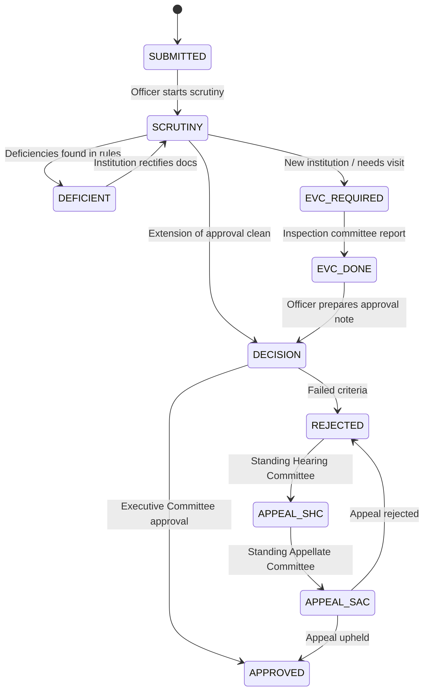

# AICTE Approval Automation System - Architecture

## 1. System Overview
The **aicte-approval-system** automates the end-to-end approval lifecycle of technical institutions under the All India Council for Technical Education (AICTE). It eliminates paper-heavy bureaucracy through automated rule-based document scrutiny, strict deterministic state-machine enforcement, SLA monitoring, and an append-only cryptographic audit trail.

```
       [ Institution ]                  [ Officer ]                   [ Committee ]
              │                              │                              │
      1. Submit Docs               3. Automated Scrutiny           4. Expert Visit
              │                              │                        Committee (EVC)
              ▼                              ▼                              │
┌───────────────────────────┐ ┌───────────────────────────┐                 │
│       Frontend UI         │ │     Hono API Backend      │                 ▼
│ Next.js App Router (TS)   │◄┼─► Strict State Machine   │◄──────── 5. Decision
│ LocalStorage Role Context │ │ AICTE Norms Rule Checker  │
└───────────────────────────┘ └─────────────┬─────────────┘
                                            │
                                            ▼
                              ┌───────────────────────────┐
                              │  Tamper-Evident Ledger    │
                              │  SHA-256 Hash Chaining    │
                              │  Audit & Proof Endpoint   │
                              └───────────────────────────┘
```

## 2. State Machine Transitions
AICTE approval follows this strict transition lifecycle:



## 3. Cryptographic Audit Ledger
Every state change creates an immutable `LedgerEntry`:
- **Formula**: `hash = SHA256(prevHash + canonicalJSON(entryFields))`
- **Chain Verification**: Validates genesis link and recomputes every block hash. If any entry or payload in the database is modified, verification flags the exact broken block ID.

## 4. Expert Visit Committee (EVC) Scheduling Engine (Phase A Prototype)

The system automates the assignment and routing of physical inspection committees for technical institutions in state `EVC_REQUIRED`:

```
┌────────────────────────────────────────────────────────┐
│             Candidate Pool (Inspectors & Apps)         │
└───────────────────────────┬────────────────────────────┘
                            │
                            ▼
┌────────────────────────────────────────────────────────┐
│     1. Pre-Solve Conflict Exclusion Filter             │
│   • Affiliations (Alumni, Ex-Employee, Family)         │
│   • Domain Qualification Match (e.g. CSE, CIVIL)       │
└───────────────────────────┬────────────────────────────┘
                            │
                            ▼
┌────────────────────────────────────────────────────────┐
│     2. Vehicle Routing Optimizer (VRP with TW)         │
│   • Primary: Google OR-Tools (optimizer/api/optimize.py)│
│   • Fallback: Zero-Setup TypeScript Heuristic          │
│   • Constraints: 2-Inspector Teams, 9h Daily Window    │
│     (09:00 - 18:00), 4h On-Site, 40 km/h, Haversine x1.3│
└───────────────────────────┬────────────────────────────┘
                            │
                            ▼
┌────────────────────────────────────────────────────────┐
│     3. Execution, Reporting & Cryptographic Ledger     │
│   • EVC_SCHEDULED: Records inspector team & solver type│
│   • EVC_REPORT_SUBMITTED: Records SHA-256 hash of      │
│     committee findings & advances status to EVC_DONE   │
└────────────────────────────────────────────────────────┘
```

### Mathematical & Operational Constraints
- **Road Distance Model**: $\text{Distance} = \text{haversine}(\text{lat}_1, \text{lng}_1, \text{lat}_2, \text{lng}_2) \times 1.3$
- **Travel Speed**: $40\text{ km/h}$
- **Shift Window**: 09:00 to 18:00 (9.0 hours maximum daily shift per inspector)
- **Visit Duration**: 4.0 hours per inspection
- **Team Size**: Exactly 2 distinct domain-qualified inspectors per institution
- **Conflict of Interest Guarantee**: Conflicted pairs are removed *prior* to solver execution, making conflicted assignments impossible
- **Baseline vs Optimized Savings**: Compares route against a naive first-fit dispatch baseline to report distance and carbon savings

---

## 5. Future Prototype Extensions
- `// TODO(next): Phase B: Authentication, RBAC & Role Isolation`
- `// TODO(next): Phase C: Smart contract anchor on Polygon / Hyperledger for multi-state decentralized notary`
