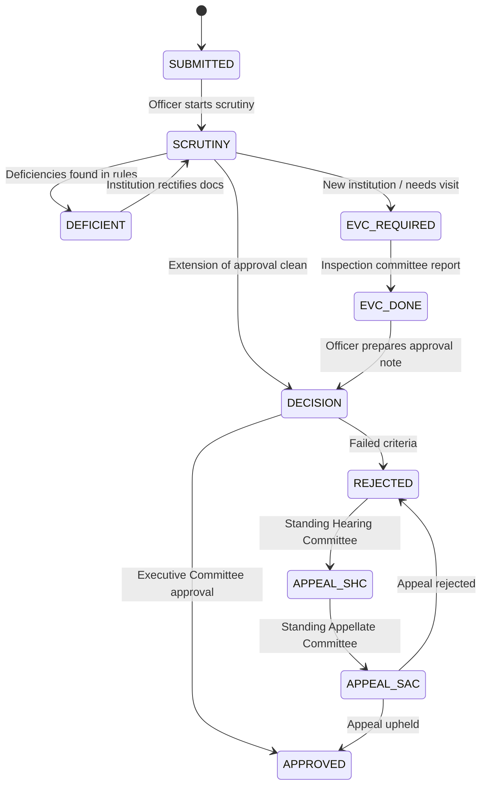

# AICTE Approval Automation System - Architecture

## 1. System Overview
The **aicte-approval-system** automates the end-to-end approval lifecycle of technical institutions under the All India Council for Technical Education (AICTE). It eliminates paper-heavy bureaucracy through automated rule-based document scrutiny, strict deterministic state-machine enforcement, SLA monitoring, and an append-only cryptographic audit trail.

```
       [ Institution ]                  [ Officer ]                   [ Committee ]
              │                              │                              │
      1. Submit Docs               3. Automated Scrutiny           4. Expert Visit
              │                              │                        Committee (EVC)
              ▼                              ▼                              │
┌───────────────────────────┐ ┌───────────────────────────┐                 │
│       Frontend UI         │ │     Hono API Backend      │                 ▼
│ Next.js App Router (TS)   │◄┼─► Strict State Machine   │◄──────── 5. Decision
│ LocalStorage Role Context │ │ AICTE Norms Rule Checker  │
└───────────────────────────┘ └─────────────┬─────────────┘
                                            │
                                            ▼
                              ┌───────────────────────────┐
                              │  Tamper-Evident Ledger    │
                              │  SHA-256 Hash Chaining    │
                              │  Audit & Proof Endpoint   │
                              └───────────────────────────┘
```

## 2. State Machine Transitions
AICTE approval follows this strict transition lifecycle:



## 3. Cryptographic Audit Ledger
Every state change creates an immutable `LedgerEntry`:
- **Formula**: `hash = SHA256(prevHash + canonicalJSON(entryFields))`
- **Chain Verification**: Validates genesis link and recomputes every block hash. If any entry or payload in the database is modified, verification flags the exact broken block ID.

## 4. Future Stubs (Out of Scope for Starter)
- `// TODO(next): Vision/Multimodal LLM extraction` for automatic OCR and clause matching from scanned PDF uploads.
- `// TODO(next): OR-Tools constraint solver` for optimal scheduling of Expert Visit Committees avoiding conflict of interest.
- `// TODO(next): Hyperledger / Ethereum smart contracts` for multi-party decentralized notary.
